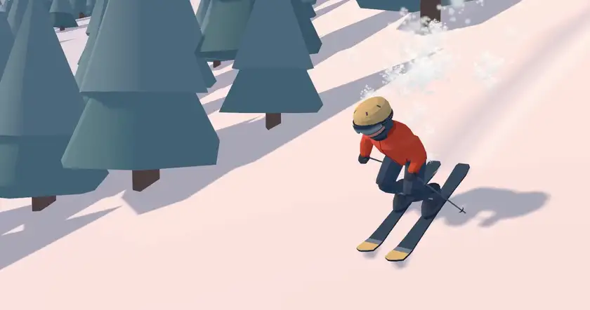
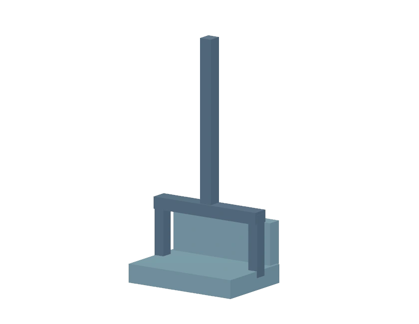
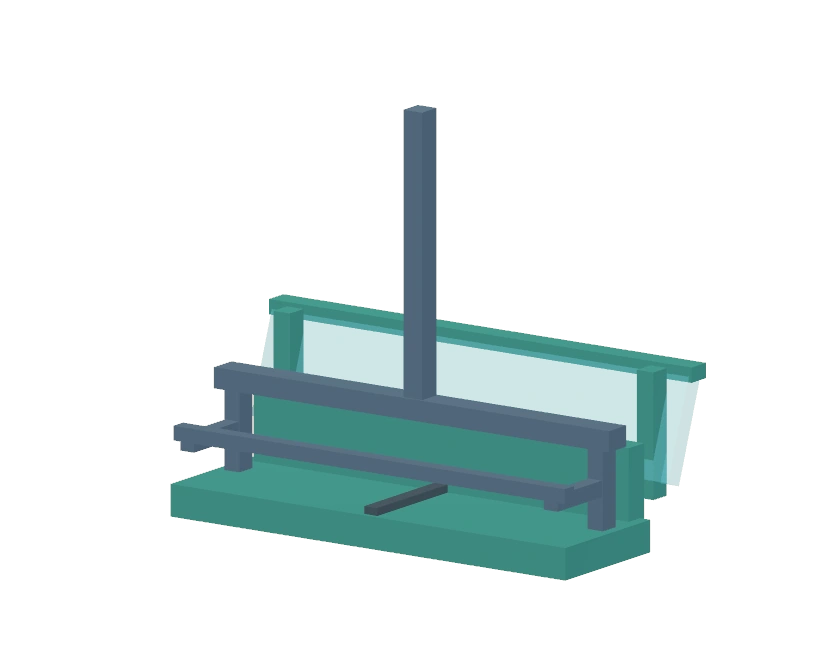
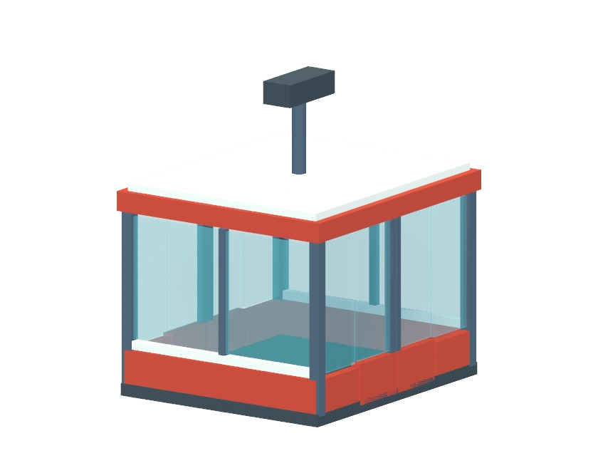
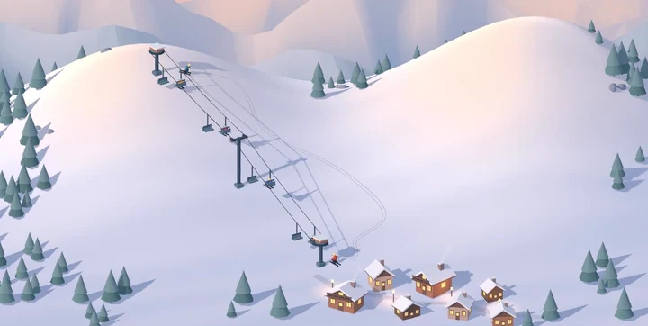
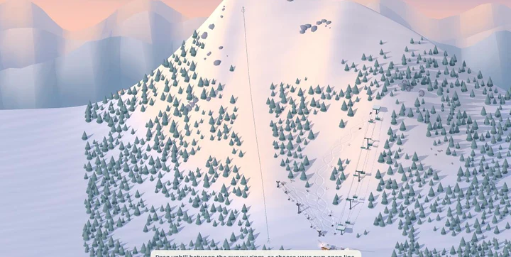
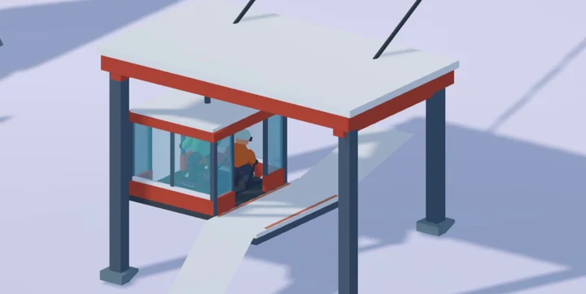

<h1 align="center">Little Lifts</h1>
<p align="center"><strong>A ski-area building game set between the pines and the summit.</strong></p>

<p align="center">
  <a href="https://little-lifts.vercel.app/play/"><strong>▶ Play in your browser</strong></a>
  &nbsp; · &nbsp;
  <a href="https://github.com/comountainclimber/little-lifts/releases/download/v0.4.1/Little-Lifts-0.4.1-macOS.dmg">Download for macOS</a>
  &nbsp; · &nbsp;
  <a href="https://github.com/comountainclimber/little-lifts/releases/download/v0.4.1/Little-Lifts-0.4.1-Windows-x64.exe">Download for Windows</a>
</p>

<a href="https://little-lifts.vercel.app/play/"><picture>
  <source media="(prefers-reduced-motion: reduce)" srcset="website/art/saddle-turn-f0b88ffeef.webp">
  
</picture></a>

Village Hill opens with one weathered chair turning over uncut snow. Draw a line down the hill and wait at the bottom for the first rider. That lap opens the Saddle double. A trail off the Saddle earns you the summit tram. By then there’s a waffle hut at the base and you can see yesterday’s little single chair from the ridge.

## Meet the lift fleet

| Village Hill | The Saddle | Summit Ridge |
| :---: | :---: | :---: |
|  |  |  |
| A single seat for the first laps. | Two seats through the timber. | A cabin to the seven cliff sites. |

## Making Little Lifts

| First tracks | The full mountain | Boarding the tram |
| :---: | :---: | :---: |
|  |  |  |

**One chair and a fall line.** The early build had an open hill, a cable and a village below it. To grow that into three lift tiers, the terrain code shapes two wooded shoulders and a bowl above the trees. The skier’s edges sample the same triangles you see on screen, so tracks follow the snow right over a change in pitch. [Mountain geometry](world/mountain.gd) · [Carve tracks](skiing/carve_track.gd)

**A pencil line through the pines.** The trail tool turns a stroke into a handful of movable bends. As you drag a bend, the planner smooths the line between its neighbors. Confirm the cut and the forest updates just the trees in that corridor. The run you drew becomes the one the next skier takes. [Trail planner](demo/trail_planner.gd) · [Forest clearing](world/scenery.gd)

**Getting on the chair.** Watch a rider’s boots at the station. The same jointed skier model shuffles forward, folds at the knees and settles onto the seat. Farther up the mountain the tram has its own rhythm, waiting at the platform before setting off. [Boarding animation](lift/transfer_guest.gd) · [Lift movement](lift/chairlift.gd)

**Filming the powder turn.** The red jacket and blue goggles in the opening shot belong to an in-game rider. As the ski loads up, its outside edge throws a short sheet of snow. The particles carry the skier’s momentum while the camera circles through a full turn. That Godot footage became the moving title screen. [Snow spray](skiing/turn_spray.gd) · [Watch the original orbit](https://little-lifts.vercel.app/art/saddle-orbit-28398bac57.mp4)

## Your first day on the hill

1. Choose **Cut a run**. Click the snow to place bends between the lift stations. Drag a bend to move it, use **Undo bend** to remove the last one, and choose **Cut trail** to open the route. Drawing from ring to ring opens a freehand trail on release. Sketching only part of a trail leaves an editable draft with links to both stations. Gentle arc, S turns, and Tree weave give you survey lines to follow. Your route can cross open snow or clear a strip through the pines.
2. Watch a skier or snowboarder use the new trail. When the first rider reaches the lower station, **Build a lift** offers the Saddle double chair. Click the two terminal locations or drag between them. The survey rings suggest one route. You can put a lift elsewhere on accessible terrain, including through the woods. Construction clears the cable corridor and skiable return. Hold **Alt** for precise placement near a survey ring.
3. Cut and ski a run served by the double chair to unlock the high-speed summit tram. Earlier lifts and trails keep running. Use the selector in **Cut a run** to return to an earlier lift.
4. Open **Village** to choose a building and click a marked plot. The first completed cut opens the waffle hut. Building the double chair opens the ski school, and the tram opens the day lodge. Ski racks, benches, and lamps appear as the resort grows.

5. Choose **Terrain** and select **Terrain park**. Click a marked site on a cut run to shape a pair of big kickers. The survey checks the approach, space between landings, slope and clearance. Select **Summit extremes** to inspect the seven ridge ledges at any time. Build the tram and cut a line that reaches one to open it. Click the survey ring above an eligible lip to open that descent.

Clouds gather and snowfall drifts across the slopes over several minutes. Each resort opens in clear light with a view of the full ski area and its surrounding range.

Construction, terrain features, trail clearings, completed runs, and building placements save automatically. Riders start a fresh lap when the resort reopens.

### Camera and controls

- Click a downhill rider, choose **Follow a rider**, or press **F** to follow a descent. The camera returns to the valley when the rider finishes.
- In **Explore**, left-drag to rotate and tilt the view. Right-drag to pan in any tool, or hold **Shift** and left-drag in Explore. Scroll or pinch to zoom at the pointer. **Space** toggles slow motion. **R** opens the mountain overview.
- Click **Mute** in the left sidebar or press **M** to toggle game sound. Little Lifts remembers your choice when you reopen it.
- **1–5** select Explore, Cut a run, Build a lift, Village, and Terrain. **Escape** cancels a stroke or returns to the overview.

### Trail signs

The left sidebar uses ski-area wayfinding signs. Explore and Cut a run show the trail key. A green circle means easy, a blue square means intermediate, and a black diamond means advanced. While cutting a trail, the key shows the grade of its steepest sustained stretch. Terrain parks have orange ovals and summit extremes have double black diamonds. Lift, village, and camera tools have their own pictograms and text labels.

## Run from source

Open `project.godot` in Godot 4.7.2 and press **F5**.

### Verify and export

Run `godot --headless --path . --script res://checks/demo_check.gd` for the interactive progression and save/reopen checks. Run `godot --headless --path . --script res://skiing/check_runs.gd` for downhill routing, terrain clearance and snow tests.

Install matching Godot 4.7.2 macOS export templates, create a build directory, and run `godot --headless --export-release macOS "build/Little Lifts.app"`.

### Browser build

With the matching Godot Web templates installed, run the following from the project root.

```sh
mkdir -p build/web
godot --headless --path . --import
godot --headless --path . --export-release Web build/web/index.html
python3 web/package_static.py build/web website/play
```

Serve `website` over HTTP. The title screen opens the game at `/play/`. Construction and sound settings are saved in browser storage for that site.
